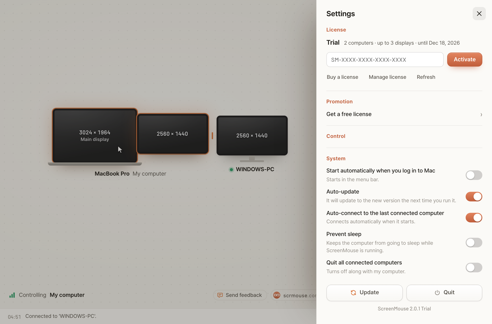

<a href="README.md">English</a> |
<a href="README.ko.md">한국어</a> |
<a href="README.ja.md">日本語</a> |
<a href="README.zh-CN.md">简体中文</a> |
<a href="README.zh-TW.md">繁體中文</a> |
<b>Deutsch</b> |
<a href="README.es.md">Español</a> |
<a href="README.fr.md">Français</a> |
<a href="README.pt-BR.md">Português</a>

  

<h1 align="center">Screen Mouse</h1>

  Eine Tastatur und eine Maus für mehrere Computer im selben Netzwerk. 
  Windows · macOS · Linux

  
  

  

Screen Mouse ist ein schlanker Software-KVM, den ich selbst entwickle und pflege. Wenn Sie den Mauszeiger über den Bildschirmrand hinaus bewegen, bewegt er sich auf dem nächsten Computer weiter. Tastatureingaben und die Zwischenablage wechseln mit.

Sie müssen keine Taste drücken und nicht warten, bis der Bildschirm umschaltet. Deshalb wechseln Sie schneller zwischen Computern als mit einem Hardware-KVM-Switch. Jeder Computer behält seinen eigenen Monitor, und Sie benötigen keine zusätzlichen Kabel oder Geräte.

## Funktionsweise

- Screen Mouse wird auf jedem Computer ausgeführt. Computer im selben Netzwerk finden sich gegenseitig. Nach der ersten Verbindung mit einem 4-stelligen Code verbinden sie sich automatisch wieder.
- Es gibt keinen Server und keinen Client. Jeder verbundene Computer kann die anderen steuern.
- Erreicht der Mauszeiger einen Bildschirmrand, gehen die Eingaben an den Computer auf dieser Seite. Die Positionen legen Sie im Bildschirm für die Monitoranordnung fest.

## Funktionen

- Gemeinsame Zwischenablage für Text und Dateien
- Dateien per Drag & Drop auf einen anderen Computer ziehen
- Monitoranordnung passend zu Ihrem Schreibtisch
- Verbindung über einen Webbrowser ohne Installation
- Strg und Befehlstaste werden automatisch getauscht, wenn Sie einen Mac von einem PC aus steuern
- Ruhezustand verhindern und alle verbundenen Computer gemeinsam beenden
- Signierte automatische Updates
- Deutsch, Englisch, Koreanisch, Japanisch, Chinesisch (vereinfacht und traditionell), Spanisch, Französisch und Portugiesisch

  

## Herunterladen

| Betriebssystem | Anforderungen | Datei |
|---|---|---|
| Windows | Windows 10 oder 11, 64 Bit | [ScreenMouse_2.0.1_Setup.exe](https://github.com/mid2tonight/ScreenMouse/releases/download/v2.0.1/ScreenMouse_2.0.1_Setup.exe) |
| macOS | macOS 13 oder höher, Apple Silicon oder Intel | [ScreenMouse_2.0.1.dmg](https://github.com/mid2tonight/ScreenMouse/releases/download/v2.0.1/ScreenMouse_2.0.1.dmg) |
| Linux | x86_64, X11 oder Wayland | [ScreenMouse_2.0.1_x86_64.AppImage](https://github.com/mid2tonight/ScreenMouse/releases/download/v2.0.1/ScreenMouse_2.0.1_x86_64.AppImage) |
| Linux (ARM) | aarch64, z. B. Raspberry Pi 4 oder 5 | [ScreenMouse_2.0.1_aarch64.AppImage](https://github.com/mid2tonight/ScreenMouse/releases/download/v2.0.1/ScreenMouse_2.0.1_aarch64.AppImage) |

Frühere Versionen finden Sie auf der Seite [Releases](https://github.com/mid2tonight/ScreenMouse/releases).

## Erste Schritte

1. Verbinden Sie Ihre Computer per Kabel oder WLAN mit demselben Router. Eine kabelgebundene Verbindung ist am schnellsten.
2. Installieren Sie Screen Mouse auf jedem Computer, und führen Sie es aus.
   - **Windows:** Führen Sie die Setupdatei aus. Administratorrechte sind nicht erforderlich.
   - **macOS:** Öffnen Sie die DMG-Datei, und ziehen Sie Screen Mouse in den Ordner **Programme**. Aktivieren Sie auf Aufforderung in den Systemeinstellungen die Option **Bedienungshilfen** für Screen Mouse.
   - **Linux:** Erlauben Sie die Ausführung der AppImage-Datei als Programm, und öffnen Sie sie anschließend. Unter Wayland ist GNOME 46 oder KDE Plasma 6.1 oder höher erforderlich.
3. Geben Sie auf einem Computer den 4-stelligen Verbindungscode ein, der auf dem anderen Computer angezeigt wird, und wählen Sie dann **Verbinden** aus.
4. Bewegen Sie den Zeiger an den Bildschirmrand. Um den Zeiger jederzeit auf diesen Computer zurückzuholen, drücken Sie **Strg+F12** (Ctrl+F12, die Taste ist änderbar).

## Kostenloser Zeitraum und Lizenz

Screen Mouse ist nach der Installation 1 Monat lang kostenlos, mit allen Standard-Funktionen (2 Computer, bis zu 3 Monitore). Zahlungsinformationen sind nicht erforderlich.

Wenn Sie an der Aktion teilnehmen, erhalten Sie einen weiteren Monat kostenlos.

Danach können Sie eine Jahreslizenz kaufen. Alle Tarife bieten dieselben Funktionen. Nur die Anzahl der Computer und Monitore unterscheidet sich.

> Dieses Repository enthält nur Dokumentation und Release-Dateien. Der Quellcode ist nicht öffentlich.
