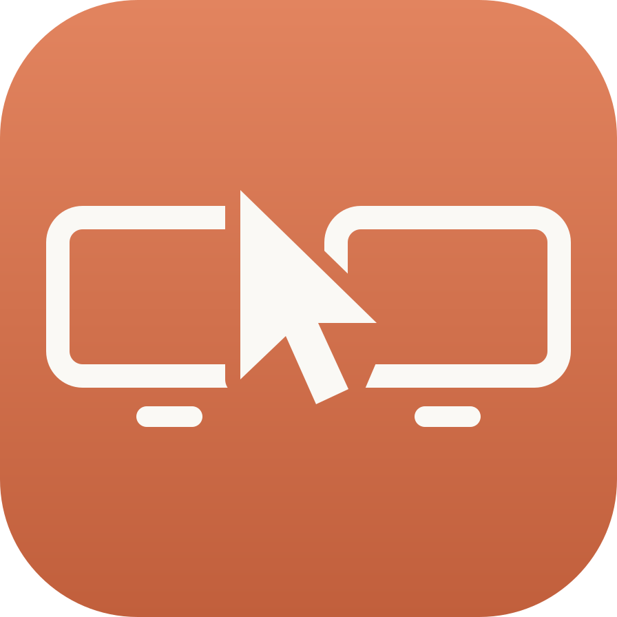
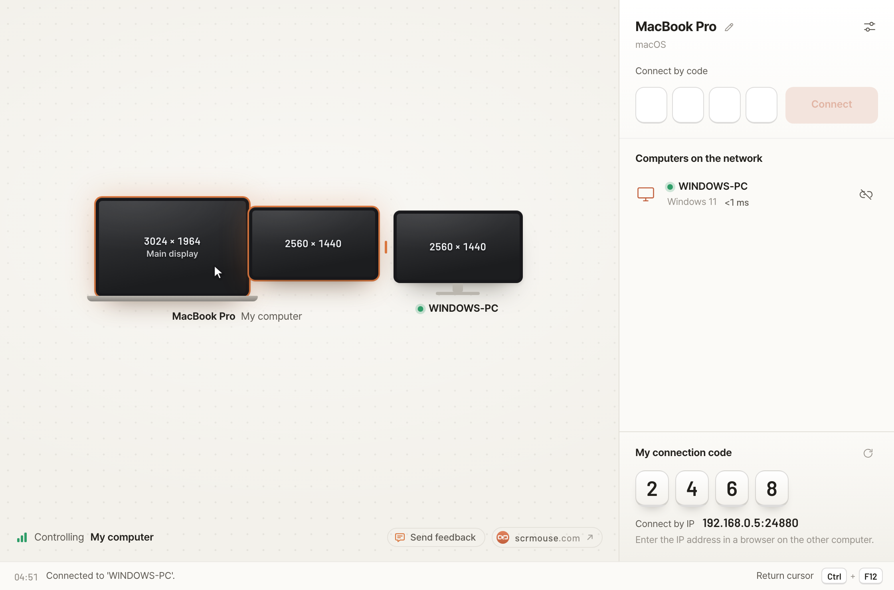

<b>English</b> |
<a href="README.ko.md">한국어</a> |
<a href="README.ja.md">日本語</a> |
<a href="README.zh-CN.md">简体中文</a> |
<a href="README.zh-TW.md">繁體中文</a> |
<a href="README.de.md">Deutsch</a> |
<a href="README.es.md">Español</a> |
<a href="README.fr.md">Français</a> |
<a href="README.pt-BR.md">Português</a>

  

<h1 align="center">Screen Mouse</h1>

  Use one keyboard and mouse with several computers on the same network. 
  Windows · macOS · Linux

  
  

  

Screen Mouse is a lightweight software KVM that I develop and maintain. Move the pointer past the edge of the screen, and it continues on the next computer. Keyboard input and the clipboard go with it.

There's no button to press and no wait for the display to switch over, so moving between computers is faster than with a hardware KVM switch. Each computer keeps its own monitor, and no extra cables or devices are needed.

## How it works

- Run Screen Mouse on each computer. Computers on the same network find each other. Connect them once with a 4-digit code, and they reconnect automatically after that.
- There is no server or client. Any connected computer can control the others.
- When the pointer reaches a screen edge, input goes to the computer on that side. You set the positions on the monitor layout screen.

## Features

- Shared clipboard for text and files
- Drag and drop files to another computer
- Monitor layout that matches your desk
- Connect from a web browser without installing
- Ctrl and Command are swapped automatically when you control a Mac from a PC
- Prevent sleep, and quit all connected computers at once
- Signed auto-updates
- English, Korean, Japanese, Chinese (Simplified and Traditional), German, Spanish, French, and Portuguese

  

## Download

| OS | Requirements | File |
|---|---|---|
| Windows | Windows 10 or 11, 64-bit | [ScreenMouse_2.0.1_Setup.exe](https://github.com/mid2tonight/ScreenMouse/releases/download/v2.0.1/ScreenMouse_2.0.1_Setup.exe) |
| macOS | macOS 13 or later, Apple silicon or Intel | [ScreenMouse_2.0.1.dmg](https://github.com/mid2tonight/ScreenMouse/releases/download/v2.0.1/ScreenMouse_2.0.1.dmg) |
| Linux | x86_64, X11 or Wayland | [ScreenMouse_2.0.1_x86_64.AppImage](https://github.com/mid2tonight/ScreenMouse/releases/download/v2.0.1/ScreenMouse_2.0.1_x86_64.AppImage) |
| Linux (ARM) | aarch64, such as Raspberry Pi 4 or 5 | [ScreenMouse_2.0.1_aarch64.AppImage](https://github.com/mid2tonight/ScreenMouse/releases/download/v2.0.1/ScreenMouse_2.0.1_aarch64.AppImage) |

Previous versions are available on the [Releases](https://github.com/mid2tonight/ScreenMouse/releases) page.

## Get started

1. Connect your computers to the same router, by cable or Wi-Fi. A wired connection is fastest.
2. Install and run Screen Mouse on each computer.
   - **Windows:** Run the setup file. Administrator rights aren't required.
   - **macOS:** Open the DMG file and drag Screen Mouse to the **Applications** folder. When prompted, turn on **Accessibility** for Screen Mouse in System Settings.
   - **Linux:** Allow the AppImage file to run as a program, and then open it. On Wayland, GNOME 46 or KDE Plasma 6.1 or later is required.
3. On one computer, enter the 4-digit connection code shown on the other computer, and then select **Connect**.
4. Move the pointer to the edge of the screen. To bring the pointer back to this computer at any time, press **Ctrl+F12** (you can change this key).

## Free period and license

Screen Mouse is free for 1 month after you install it, with all Standard features (2 computers, up to 3 monitors). No payment information is required.

If you join the promotion, you get 1 more month free.

After that, you can buy a yearly license. All plans have the same features. Only the number of computers and monitors differs.

> This repository contains documentation and release files only. The source code is not public.
